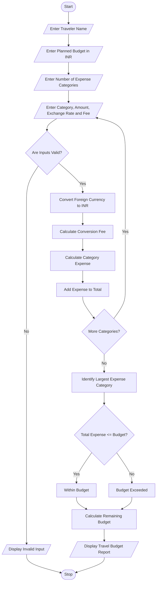

# 9. Multi-Currency Travel Budget Analysis Using Python

## 1. Problem Statement

Develop a Python program for a Multi-Currency Travel Budget Analysis System that calculates travel expenses in different currencies and converts them into a single base currency using supplied exchange rates.

The system accepts travel expense details such as accommodation, food, transportation, shopping, and entertainment expenses. It also accepts exchange rates, currency conversion fees, and the planned travel budget.

The program performs the following operations:

- Currency Conversion: Converts expenses from foreign currencies into the base currency.
- Conversion Fee: Adds a specified percentage of conversion fees to each expense.
- Total Expenses: Calculates the total travel expenditure.
- Budget Comparison: Compares the total expenses against the planned budget.
- Largest Expense Category: Identifies the category in which the highest amount was spent.

Finally, the program generates a travel budget report displaying converted expenses, conversion fees, total spending, remaining budget, and the largest expense category.

## 2. Algorithm

1. Start the program.
2. Enter the traveler's name.
3. Enter the planned travel budget in the base currency (INR).
4. Enter the number of expense categories.
5. For each expense category:
   - Enter the expense category name.
   - Enter the expense amount in foreign currency.
   - Enter the exchange rate.
   - Enter the currency conversion fee percentage.
6. Validate all input values.
7. Convert the foreign currency amount into INR.

Converted Amount = Foreign Amount × Exchange Rate

8\. Calculate the conversion fee.

Conversion Fee = Converted Amount × Fee Percentage / 100

9\. Calculate the total expense for each category.

Category Expense = Converted Amount + Conversion Fee

10. Calculate the total travel expenditure by adding all category expenses.
11. Identify the largest expense category.
12. Compare total expenditure with the planned budget.
    - If total expenditure is less than or equal to the budget, display "Within Budget".
    - Otherwise, display "Budget Exceeded".
13. Calculate the remaining budget or excess spending.
14. Display the complete travel budget report.
15. Stop the program.

## 3. Flowchart (Mermaid)


## 5. Sample Input

Travel Details

```
Enter traveler name: Rahul

Enter planned budget in INR: Rs. 50000

Enter number of expense categories: 4

Expense Category 1
Enter category name: Accommodation
Enter expense amount in foreign currency: 200
Enter exchange rate (INR per unit): 90
Enter conversion fee percentage: 2

Expense Category 2
Enter category name: Food
Enter expense amount in foreign currency: 100
Enter exchange rate (INR per unit): 90
Enter conversion fee percentage: 2

Expense Category 3
Enter category name: Transportation
Enter expense amount in foreign currency: 150
Enter exchange rate (INR per unit): 90
Enter conversion fee percentage: 2

Expense Category 4
Enter category name: Shopping
Enter expense amount in foreign currency: 100
Enter exchange rate (INR per unit): 90
Enter conversion fee percentage: 2
```

## 6. Sample Output

Travel Budget Report

Within Budget

```
==============================================
          TRAVEL BUDGET REPORT
==============================================

Traveler Name       : Rahul
Planned Budget      : Rs. 50000.0

----------------------------------------------
Total Conversion Fees: Rs. 990.0

Total Travel Expense: Rs. 50490.0

Largest Expense Category: Accommodation

Largest Category Amount: Rs. 18360.0

----------------------------------------------

Budget Exceeded By : Rs. 490.0

Budget Status      : BUDGET EXCEEDED

==============================================
      TRAVEL ANALYSIS COMPLETED
==============================================
```

## 7. Explanation of Python Concepts Used

| Python concept         | Application                         |
| ---------------------- | ----------------------------------- |
| Variables              | Store traveler details and expenses |
| Input statements       | Accept travel information           |
| Data types             | String, integer and float           |
| For loop               | Process multiple expense categories |
| Conditional statements | Compare expenses with budget        |
| Arithmetic operators   | Calculate conversions and fees      |
| Comparison operators   | Identify largest expense            |
| Accumulator variables  | Calculate total expenses and fees   |
| If-else statements     | Identify budget status              |
| Type conversion        | Convert input into numeric values   |
| Print statements       | Display travel budget report        |

