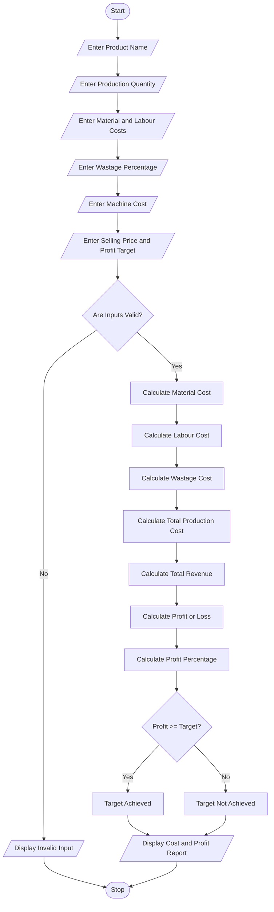

# 8. Manufacturing Cost and Profitability Analysis Using Python

## 1. Problem Statement

Develop a Python program for a Manufacturing Cost and Profitability Analysis System to calculate the total production cost and determine whether the manufacturing process achieves the specified profit target.

The system accepts details such as the quantity of products manufactured, material cost per unit, labour charges per unit, wastage percentage, machine operating cost, selling price per unit, and expected profit target.

The program calculates:

- Material Cost: Total cost of raw materials required for production.
- Labour Cost: Total wages paid to workers.
- Wastage Cost: Additional cost caused by material wastage.
- Machine Cost: Total cost of operating manufacturing machines.
- Total Production Cost: Sum of all manufacturing expenses.
- Total Revenue: Income earned by selling manufactured products.
- Profit or Loss: Difference between total revenue and production cost.

Finally, the program compares the actual profit with the specified profit target and displays whether the production meets the expected profitability level.

## 2. Algorithm

1. Start the program.
2. Enter the product name.
3. Enter the total production quantity.
4. Enter the material cost per unit.
5. Enter the labour cost per unit.
6. Enter the wastage percentage.
7. Enter the machine operating cost.
8. Enter the selling price per unit.
9. Enter the expected profit target.
10. Validate all input values.
11. Calculate total material cost.

Material Cost = Quantity × Material Cost per Unit

12\. Calculate total labour cost.

Labour Cost = Quantity × Labour Cost per Unit

13\. Calculate wastage cost.

Wastage Cost = (Material Cost × Wastage Percentage) / 100

14\. Calculate total production cost.

Total Production Cost = Material Cost + Labour Cost + Wastage Cost + Machine Cost

15\. Calculate total revenue.

Total Revenue = Quantity × Selling Price per Unit

16\. Calculate profit or loss.

Profit = Total Revenue − Total Production Cost

17\. Calculate profit percentage.

Profit Percentage = (Profit / Total Production Cost) × 100

18. Compare actual profit with the expected profit target.
    - If actual profit is greater than or equal to the target, display "Target Achieved".
    - Otherwise, display "Target Not Achieved".
19. Display the complete manufacturing cost and profitability report.
20. Stop the program.

## 3. Flowchart (Mermaid)



## 4.Sample Input

Manufacturing Details

```
Enter product name: Plastic Bottles

Enter production quantity: 1000

Enter material cost per unit: Rs. 20

Enter labour cost per unit: Rs. 5

Enter wastage percentage: 10

Enter machine operating cost: Rs. 5000

Enter selling price per unit: Rs. 40

Enter expected profit target: Rs. 8000
```

## 5. Sample Output

Manufacturing Cost Report

Target Achieved

```
==============================================
       MANUFACTURING COST REPORT
==============================================

Product Name          : Plastic Bottles
Production Quantity   : 1000

----------------------------------------------
              COST DETAILS
----------------------------------------------

Material Cost         : Rs. 20000.0
Labour Cost           : Rs. 5000.0
Wastage Cost          : Rs. 2000.0
Machine Cost          : Rs. 5000.0

----------------------------------------------
Total Production Cost : Rs. 32000.0

Total Revenue         : Rs. 40000.0

Profit / Loss         : Rs. 8000.0

Profit Percentage     : 25.0 %

Expected Profit       : Rs. 8000.0

----------------------------------------------
Production Status     : TARGET ACHIEVED

==============================================
     ANALYSIS COMPLETED SUCCESSFULLY
==============================================
```

## 6. Explanation of Python Concepts Used

| Python concept         | Application                             |
| ---------------------- | --------------------------------------- |
| Variables              | Store product and manufacturing details |
| Input statements       | Accept production information           |
| Data types             | String, integer and float               |
| Arithmetic operators   | Calculate costs, revenue and profit     |
| Conditional statements | Check profit target                     |
| Comparison operators   | Validate input and compare profit       |
| Type conversion        | Convert input into numeric values       |
| If-else statements     | Identify profit or loss                 |
| Print statements       | Generate manufacturing report           |
