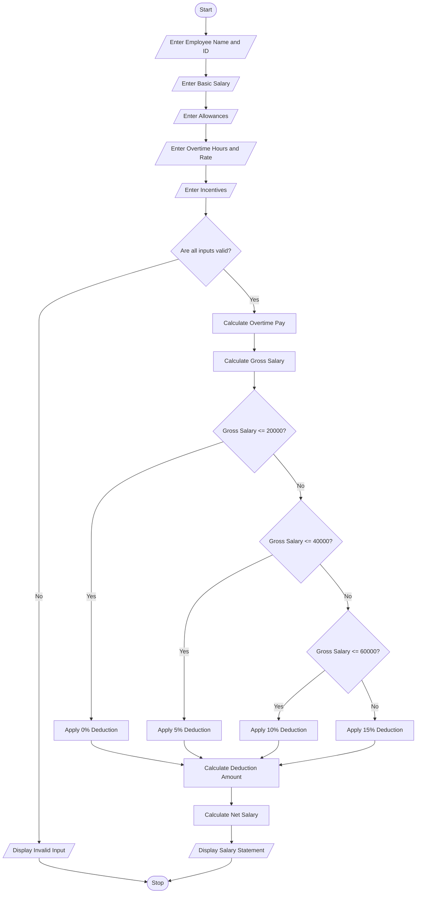

# 4.Employee Payroll and Deduction Analysis Using Python

## 1. Problem Statement

Develop a Python program for an Employee Payroll and Deduction Analysis System to calculate the monthly salary of employees based on basic pay, allowances, overtime, and incentives.

The system accepts employee details such as employee name, employee ID, basic salary, allowances, overtime hours, overtime rate, and incentives.

The program calculates the gross salary by adding basic pay, allowances, overtime earnings, and incentives.

It then applies progressive deductions based on the gross salary using the following assumed deduction policy:

- Gross salary up to ₹20,000: No deduction.
- Gross salary from ₹20,001 to ₹40,000: 5% deduction.
- Gross salary from ₹40,001 to ₹60,000: 10% deduction.
- Gross salary above ₹60,000: 15% deduction.

Finally, the program calculates the net salary after deductions and generates a formatted salary statement displaying all earnings, deductions, gross salary, and net salary.

## 2. Algorithm

1. Start the program.
2. Enter employee name and employee ID.
3. Enter basic salary.
4. Enter allowances.
5. Enter overtime hours and overtime rate.
6. Enter incentives.
7. Validate all input values. Negative values are not allowed.
8. Calculate overtime pay.

Overtime Pay = Overtime Hours × Overtime Rate

9\. Calculate gross salary.

Gross Salary = Basic Salary + Allowances + Overtime Pay + Incentives

10. Apply progressive deductions:
    - If gross salary is up to ₹20,000, deduction is 0%.
    - If gross salary is up to ₹40,000, deduction is 5%.
    - If gross salary is up to ₹60,000, deduction is 10%.
    - Otherwise, deduction is 15%.
11. Calculate deduction amount.
12. Calculate net salary.

Net Salary = Gross Salary − Deduction

13. Display the formatted salary statement.
14. Stop the program.

## 3. Flowchart (Mermaid)



## 5. Sample Input

Employee Details

```
Enter employee name: Rahul
Enter employee ID: EMP101

Enter basic salary: Rs. 30000
Enter allowances: Rs. 5000
Enter overtime hours: 10
Enter overtime rate per hour: Rs. 200
Enter incentives: Rs. 3000
```

## 6. Sample Output

Employee Salary Statement

Generated

```
==========================================
           SALARY STATEMENT
==========================================

Employee Name       : Rahul
Employee ID         : EMP101

------------------------------------------
                EARNINGS
------------------------------------------

Basic Salary        : Rs. 30000.0
Allowances          : Rs. 5000.0
Overtime Pay        : Rs. 2000.0
Incentives          : Rs. 3000.0

------------------------------------------
Gross Salary        : Rs. 40000.0
Deduction Rate      : 5.0 %
Total Deduction     : Rs. 2000.0

------------------------------------------
Net Salary          : Rs. 38000.0

==========================================
      PAYROLL GENERATED SUCCESSFULLY
==========================================
```

## 7. Explanation of Python Concepts Used

| Python concept         | Application                       |
| ---------------------- | --------------------------------- |
| Variables              | Store employee and salary details |
| Input statements       | Accept employee information       |
| Data types             | String, integer and float         |
| Arithmetic operators   | Calculate gross and net salary    |
| Conditional statements | Apply salary deductions           |
| Comparison operators   | Check salary ranges               |
| Type conversion        | Convert input into numeric values |
| Print statements       | Generate salary statement         |


