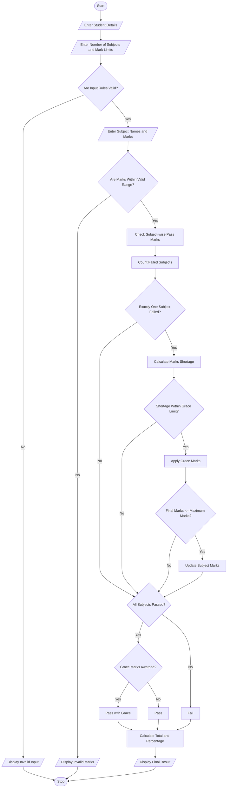

# 11. Examination Result and Grace-Mark Validation Using Python

## 1. Problem Statement

Develop a Python program for an Examination Result and Grace-Mark Validation System to process student marks across multiple subjects, check subject-wise pass criteria, apply grace marks according to a specified policy, and generate the final examination result.

The system accepts the student's name, roll number, number of subjects, maximum marks, minimum passing marks, and marks obtained in each subject.

The program performs the following operations:

- Marks Validation: Checks that marks are not negative and do not exceed the maximum marks.
- Subject-wise Pass Criteria: Checks whether the student has secured the minimum passing marks in each subject.
- Grace Marks: If a student fails in only one subject by a maximum of 5 marks, grace marks are awarded to help the student pass.
- Maximum Marks Validation: Ensures that grace marks do not increase marks beyond the maximum marks.
- Final Classification: Classifies students as Pass, Pass with Grace, or Fail.
- Percentage Calculation: Calculates the overall percentage based on the final marks.

Finally, the system displays subject-wise marks, grace marks awarded, total marks, percentage, and final examination result.

## 2. Algorithm

1. Start the program.
2. Enter the student's name and roll number.
3. Enter the number of subjects.
4. Enter the maximum marks per subject.
5. Enter the minimum passing marks.
6. Enter the grace-mark limit.
7. Validate all input values.
8. For each subject:
   - Enter the subject name.
   - Enter the marks obtained.
   - Check whether marks are within the valid range.
9. Check subject-wise pass criteria.
10. If the student fails in exactly one subject and the shortage is within the grace-mark limit:
    - Calculate the required grace marks.
    - Add grace marks to the subject.
    - Ensure that final marks do not exceed maximum marks.
11. If the student passes all subjects after grace marks, classify as Pass with Grace.
12. If the student passes all subjects without grace marks, classify as Pass.
13. Otherwise, classify as Fail.
14. Calculate total marks and percentage using final marks.
15. Display the subject-wise result and final classification.
16. Stop the program.

## 3. Flowchart (Mermaid)


## 4. Sample Input

Student Examination Details

```
Enter student name: Rahul
Enter roll number: 101

Enter number of subjects: 5
Enter maximum marks per subject: 100
Enter minimum passing marks: 35
Enter grace mark limit: 5

Subject 1
Enter subject name: Mathematics
Enter marks obtained: 78

Subject 2
Enter subject name: Physics
Enter marks obtained: 32

Subject 3
Enter subject name: Chemistry
Enter marks obtained: 65

Subject 4
Enter subject name: English
Enter marks obtained: 80

Subject 5
Enter subject name: Computer Science
Enter marks obtained: 90
```

## 5. Sample Output

Examination Result

Pass with Grace

```
==============================================
           EXAMINATION RESULT
==============================================

Student Name : Rahul
Roll Number  : 101

----------------------------------------------
             SUBJECT DETAILS
----------------------------------------------

Mathematics : 78 / 100
Physics : 35 / 100
Chemistry : 65 / 100
English : 80 / 100
Computer Science : 90 / 100

----------------------------------------------

Grace Marks Awarded : 3

Total Marks Obtained: 348

Maximum Total Marks : 500

Percentage          : 69.6 %

----------------------------------------------

Final Result        : PASS WITH GRACE

==============================================
      RESULT GENERATED SUCCESSFULLY
==============================================
```

## 6. Explanation of Python Concepts Used

| Python concept       | Application                         |
| -------------------- | ----------------------------------- |
| Variables            | Store student details and marks     |
| Input statements     | Accept student information          |
| Data types           | String and integer                  |
| Lists                | Store subject names and marks       |
| For loop             | Process multiple subjects           |
| If-else statements   | Apply pass and fail conditions      |
| Nested conditions    | Apply grace-mark policy             |
| Comparison operators | Validate marks and passing criteria |
| Arithmetic operators | Calculate total and percentage      |
| List operations      | Append subject names and marks      |
| `sum()` function     | Calculate total marks               |
| Type conversion      | Convert input into integer values   |

