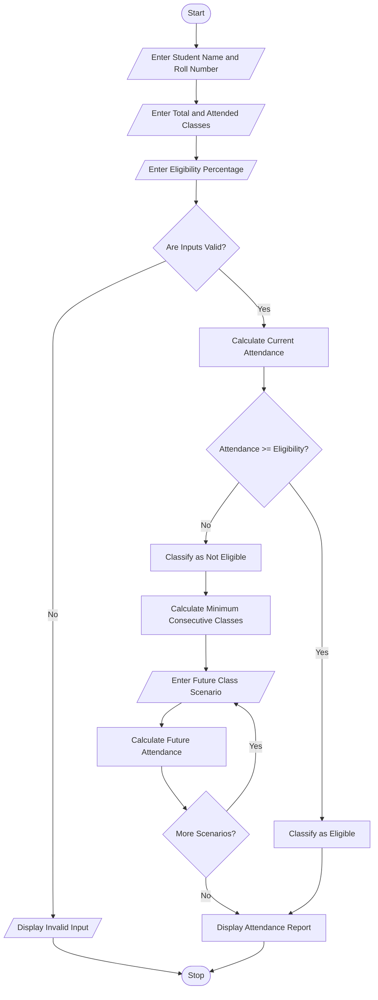

# 12. Attendance Recovery Computation Using Python

## 1. Problem Statement

Develop a Python program for an Attendance Recovery Computation System to calculate a student's current attendance percentage and determine the minimum number of consecutive classes required to reach a specified attendance eligibility threshold.

The system accepts the student's name, roll number, total classes conducted, classes attended, and minimum required attendance percentage.

The program performs the following operations:

- Current Attendance: Calculates the student's present attendance percentage.
- Eligibility Checking: Checks whether the student meets the required attendance percentage.
- Recovery Calculation: Determines the minimum number of consecutive classes the student must attend to reach the eligibility threshold.
- Future Attendance Scenarios: Calculates attendance recovery under different future scenarios, such as attending all upcoming classes or missing some classes.
- Final Classification: Classifies the student as Eligible or Not Eligible.

The system generates an attendance report displaying current attendance, required attendance, minimum recovery classes, and future attendance scenarios.

## 2. Algorithm

1. Start the program.
2. Enter the student's name and roll number.
3. Enter the total number of classes conducted.
4. Enter the number of classes attended.
5. Enter the minimum attendance eligibility percentage.
6. Validate the entered values:
   - Total classes must be greater than zero.
   - Attended classes must not exceed total classes.
   - Eligibility percentage must be between 0 and 100.
7. Calculate current attendance percentage.

Current Attendance = (Classes Attended / Total Classes) × 100

8. Check whether the student meets the eligibility threshold.
   - If current attendance is greater than or equal to the threshold, classify as Eligible.
   - Otherwise, classify as Not Eligible.
9. If the student is not eligible:
   - Assume the student attends every upcoming class.
   - Calculate the minimum number of consecutive classes required to reach the threshold.

\\[ \frac{A+x}{T+x}\times100\geq R \\]

Where:

- A = Classes attended
- T = Total classes conducted
- x = Additional consecutive classes attended
- R = Required attendance percentage

10. Calculate future attendance under different scenarios:
    - Attend all upcoming classes.
    - Attend 80% of upcoming classes.
    - Attend 50% of upcoming classes.
11. Display the current attendance and recovery details.
12. Stop the program.

## 3. Flowchart (Mermaid)


## 5. Sample Input

Student Attendance Details

```
Enter student name: Rahul

Enter roll number: 101

Enter total classes conducted: 100

Enter classes attended: 65

Enter required attendance percentage: 75
```

## 6. Sample Output

Attendance Recovery Report

Not Eligible

```
==============================================
           ATTENDANCE REPORT
==============================================

Student Name : Rahul
Roll Number  : 101
Total Classes: 100
Attended     : 65

Current Attendance: 65.0 %

Required Attendance: 75.0 %

Eligibility Status: NOT ELIGIBLE

Minimum Consecutive Classes Required: 40

----------------------------------------------
       FUTURE ATTENDANCE SCENARIOS
----------------------------------------------

Future Attendance Rate: 100 %

Classes Attended in Future: 40

Future Attendance Percentage: 75.0 %

Future Attendance Rate: 80 %

Classes Attended in Future: 32

Future Attendance Percentage: 70.0 %

Future Attendance Rate: 50 %

Classes Attended in Future: 20

Future Attendance Percentage: 60.71 %

==============================================
     ATTENDANCE ANALYSIS COMPLETED
==============================================
```

## 7. Explanation of Python Concepts Used

| Python concept         | Application                          |
| ---------------------- | ------------------------------------ |
| Variables              | Store student and attendance details |
| Input statements       | Accept attendance information        |
| Data types             | String, integer and float            |
| Arithmetic operators   | Calculate attendance percentage      |
| Conditional statements | Check eligibility                    |
| For loop               | Process future attendance scenarios  |
| Lists                  | Store different attendance scenarios |
| Comparison operators   | Compare attendance with eligibility  |
| `math.ceil()`          | Calculate minimum recovery classes   |
| `math.floor()`         | Calculate future classes attended    |
| Type conversion        | Convert input into numeric values    |
| Print statements       | Display attendance report            |

