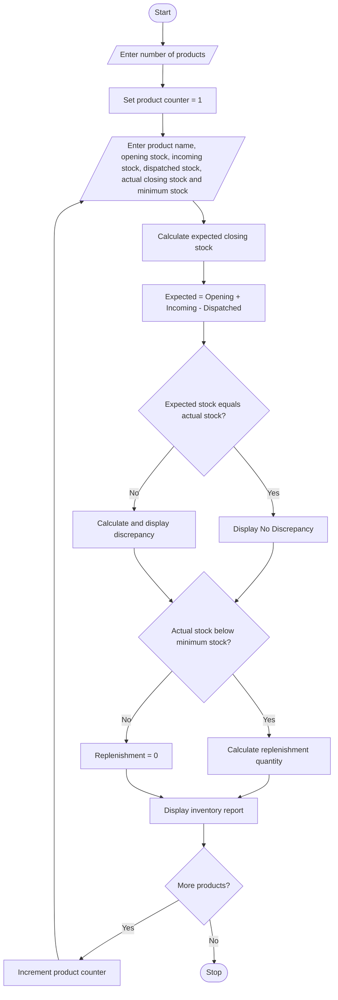

# 14. Warehouse Inventory Reconciliation

## 1. Problem Statement

Develop a Python program to perform warehouse inventory reconciliation for multiple products. The program should accept the product name, opening stock, incoming quantities, dispatched quantities, and actual closing stock.

It should calculate the expected closing stock using the formula:

Expected Closing Stock = Opening Stock + Incoming Quantity − Dispatched Quantity

The program compares the expected closing stock with the actual closing stock and identifies any discrepancies. It also calculates the replenishment quantity required to meet the minimum stock level.

## 2. Algorithm

1. Start the program.
2. Read the number of products.
3. For each product:
   - Read the product name.
   - Read opening stock.
   - Read incoming quantity.
   - Read dispatched quantity.
   - Read actual closing stock.
   - Read minimum stock level.
4. Calculate expected closing stock.
5. Compare expected closing stock with actual closing stock.
6. If both values are equal, display "No Discrepancy".
7. Otherwise, display the stock discrepancy.
8. Calculate replenishment quantity:
   - If actual closing stock is below minimum stock, calculate the required quantity.
   - Otherwise, replenishment is zero.
9. Display the inventory report for all products.
10. Stop the program.

## 3. Flowchart (Mermaid)


## 5. Sample Input

```
Enter the number of products: 3

Enter details for Product 1
Product name: Rice
Opening stock: 500
Incoming quantity: 200
Dispatched quantity: 300
Actual closing stock: 400
Minimum stock level: 250

Enter details for Product 2
Product name: Sugar
Opening stock: 300
Incoming quantity: 100
Dispatched quantity: 250
Actual closing stock: 130
Minimum stock level: 200

Enter details for Product 3
Product name: Oil
Opening stock: 200
Incoming quantity: 150
Dispatched quantity: 100
Actual closing stock: 260
Minimum stock level: 150
```

## 6. Sample Output

```
========== WAREHOUSE INVENTORY REPORT ==========

Product Name: Rice
Opening Stock: 500
Incoming Quantity: 200
Dispatched Quantity: 300
Expected Closing Stock: 400
Actual Closing Stock: 400
Discrepancy: 0
Status: No Discrepancy
Replenishment Required: 0

Product Name: Sugar
Opening Stock: 300
Incoming Quantity: 100
Dispatched Quantity: 250
Expected Closing Stock: 150
Actual Closing Stock: 130
Discrepancy: -20
Status: Stock Shortage
Replenishment Required: 70

Product Name: Oil
Opening Stock: 200
Incoming Quantity: 150
Dispatched Quantity: 100
Expected Closing Stock: 250
Actual Closing Stock: 260
Discrepancy: 10
Status: Excess Stock
Replenishment Required: 0

========== REPORT COMPLETED ==========
```

## Explanation of Important Concepts

- Variables: Store product details such as opening stock and closing stock.
- Operators: Perform addition, subtraction, and comparison.
- Conditional statements: Identify stock shortages, excess stock, and discrepancies.
- For loop: Processes multiple products.
- Lists: Store the inventory details of all products.
- Tuples: Group the details of each product.

