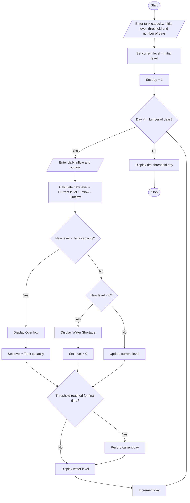

# 16. Multi-Day Water Tank Simulation

## 1. Problem Statement

Develop a Python program to simulate the water level in a tank over multiple days. The program should accept the tank's capacity, initial water level, daily water inflow, and daily water outflow.

The program should update the water level for each day, detect overflow and water shortages, and determine the first day on which the water level reaches or exceeds a specified threshold.

The water level is calculated using the formula:

Water Level = Previous Water Level + Inflow − Outflow

The program should ensure that the water level does not exceed the tank capacity or fall below zero.

## 2. Algorithm

1. Start the program.
2. Read the tank capacity.
3. Read the initial water level.
4. Read the required threshold level.
5. Read the number of days.
6. Set the current water level to the initial water level.
7. Set the first threshold day to "Not Reached".
8. Repeat for each day:
   - Read the inflow quantity.
   - Read the outflow quantity.
   - Calculate the new water level.
   - If the new level exceeds tank capacity, display overflow and set the water level to tank capacity.
   - If the new level is below zero, display shortage and set the water level to zero.
   - Otherwise, update the water level normally.
   - Check whether the water level reaches or exceeds the threshold.
   - If it is the first time, record the day.
   - Display the water level.
9. Display the first day the threshold was reached.
10. Stop the program.

## 3. Flowchart (Mermaid)


## 5. Sample Input

```
Enter tank capacity: 1000
Enter initial water level: 500
Enter threshold water level: 800
Enter number of days: 5

Day 1
Enter water inflow: 200
Enter water outflow: 100

Day 2
Enter water inflow: 300
Enter water outflow: 50

Day 3
Enter water inflow: 400
Enter water outflow: 100

Day 4
Enter water inflow: 50
Enter water outflow: 200

Day 5
Enter water inflow: 100
Enter water outflow: 150
```

## 6. Sample Output

```
========== WATER TANK REPORT ==========
Initial Water Level: 500.0

Day 1
Status: Normal
Current Water Level: 600.0

Day 2
Status: Normal
Current Water Level: 850.0

Day 3
Status: Overflow Detected
Overflow Quantity: 150.0
Current Water Level: 1000.0

Day 4
Status: Normal
Current Water Level: 850.0

Day 5
Status: Normal
Current Water Level: 800.0

========== FINAL REPORT ==========
Final Water Level: 800.0
Threshold First Reached on Day: 2
```

## Explanation of Important Python Concepts

- Variables: Store tank capacity, water level, inflow, and outflow.
- Data types: Use integers or floating-point numbers for water quantities.
- Operators: Perform addition, subtraction, and comparisons.
- Conditional statements: Detect overflow, shortage, and threshold conditions.
- For loop: Simulates water changes over multiple days.
- None: Indicates that the threshold has not yet been reached.

