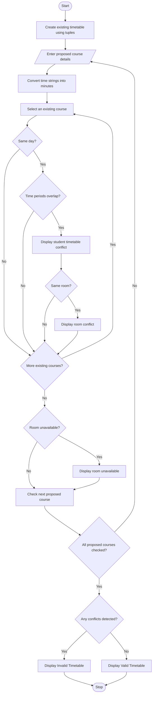

# 23. Student Timetable Conflict Detection

## 1. Problem Statement

Develop a Python program to detect timetable conflicts for students and classrooms. The program should store course schedules using strings and tuples, including course name, day, starting time, ending time, and room number.

The program should perform the following operations:

1. Compare course schedules and detect overlapping time periods on the same day.
2. Identify room conflicts when two courses are scheduled in the same room at overlapping times.
3. Check whether a room is unavailable during a proposed class period.
4. Validate a proposed timetable and display whether it is valid or contains conflicts.

Time Overlap Condition:

Two classes overlap when:

`Start1 < End2 AND Start2 < End1`

For example, a class from 9:00 AM to 10:00 AM conflicts with a class from 9:30 AM to 10:30 AM.

## 2. Algorithm

1. Start the program.
2. Create a list of existing course schedules using tuples.
3. Store course name, day, start time, end time, and room number.
4. Read the number of proposed courses.
5. For each proposed course:
   - Read course name.
   - Read day.
   - Read starting time.
   - Read ending time.
   - Read room number.
6. Convert the time strings into minutes.
7. Compare the proposed course with existing courses.
8. Check whether the courses are scheduled on the same day.
9. Check whether their time periods overlap.
10. If the times overlap, identify:
    - Student timetable conflict.
    - Room conflict if both courses use the same room.
11. Check whether the proposed room is unavailable.
12. Display all detected conflicts.
13. If no conflicts are found, display "Timetable is Valid".
14. Otherwise, display "Timetable Contains Conflicts".
15. Stop the program.

## 3. Flowchart (Mermaid)


## 5. Sample Input

```
Enter number of proposed courses: 3

Enter details for course 1
Course name: Data Structures
Day: Monday
Start time (HH:MM): 09:30
End time (HH:MM): 10:30
Room number: R101

Enter details for course 2
Course name: English
Day: Tuesday
Start time (HH:MM): 11:00
End time (HH:MM): 12:00
Room number: R105

Enter details for course 3
Course name: Computer Networks
Day: Wednesday
Start time (HH:MM): 11:30
End time (HH:MM): 12:30
Room number: R101
```

## 6. Sample Output

```
========== TIMETABLE VALIDATION ==========

Course: Data Structures
Student Timetable Conflict with: Python
Room Conflict with: Python

Course: English

Course: Computer Networks
Student Timetable Conflict with: Chemistry
Room R101 is unavailable.

Result: Timetable Contains Conflicts.
```

## Explanation of Important Python Concepts

- Strings: Store course names, days, room numbers, and time values.
- Tuples: Store course schedules as a collection of related details.
- Lists: Store existing and proposed timetables.
- Functions: Perform time conversion and detect overlapping periods.
- Conditional statements: Identify timetable and room conflicts.
- Loops: Compare multiple courses and validate the timetable.
- String operations: Split the time string into hours and minutes.

