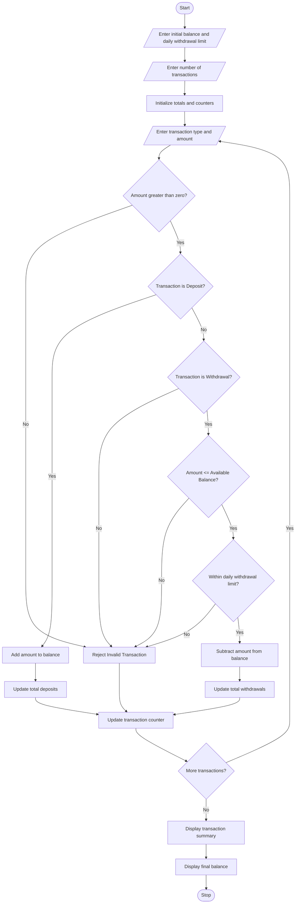

# 13. ATM Transaction Sequence Simulation

## 1. Problem Statement

Develop a Python program to simulate ATM transactions by processing a sequence of deposits and withdrawals. The program should maintain the account balance after every transaction, enforce daily withdrawal limits, reject invalid transactions, and generate a transaction summary.

The program should perform the following operations:

1. Accept the initial account balance.
2. Process multiple deposit and withdrawal transactions.
3. Update the account balance after every valid transaction.
4. Reject transactions involving zero or negative amounts.
5. Reject withdrawals exceeding the available balance.
6. Enforce a maximum daily withdrawal limit.
7. Display the final balance and transaction summary.

Formulas:

- Deposit: New Balance = Old Balance + Deposit Amount
- Withdrawal: New Balance = Old Balance − Withdrawal Amount
- Remaining Withdrawal Limit = Daily Limit − Total Withdrawals

## 2. Algorithm

1. Start the program.
2. Read the initial account balance.
3. Read the maximum daily withdrawal limit.
4. Read the number of transactions.
5. Initialize deposit total, withdrawal total, and transaction counters to zero.
6. Repeat for each transaction:
   - Read transaction type (Deposit or Withdrawal).
   - Read transaction amount.
   - Check whether the amount is positive.
   - If it is a deposit, add the amount to the account balance.
   - If it is a withdrawal:
     - Check whether the amount exceeds the available balance.
     - Check whether the amount exceeds the remaining daily withdrawal limit.
     - If both conditions are satisfied, subtract the amount from the balance.
     - Otherwise, reject the transaction.
   - Display the transaction result and updated balance.
7. Calculate the total deposits and withdrawals.
8. Display the number of successful and rejected transactions.
9. Display the final account balance.
10. Stop the program.

## 3. Flowchart 


## 5. Sample Input

```
Enter initial account balance: 10000
Enter daily withdrawal limit: 5000
Enter number of transactions: 5

Transaction 1
Enter transaction type (Deposit/Withdrawal): deposit
Enter transaction amount: 2000

Transaction 2
Enter transaction type (Deposit/Withdrawal): withdrawal
Enter transaction amount: 3000

Transaction 3
Enter transaction type (Deposit/Withdrawal): withdrawal
Enter transaction amount: 2500

Transaction 4
Enter transaction type (Deposit/Withdrawal): deposit
Enter transaction amount: 1000

Transaction 5
Enter transaction type (Deposit/Withdrawal): withdrawal
Enter transaction amount: 1000
```

## 6. Sample Output

```
========== ATM TRANSACTION DETAILS ==========

Transaction 1
Deposit Successful.
Updated Balance: 12000.0

Transaction 2
Withdrawal Successful.
Updated Balance: 9000.0

Transaction 3
Transaction Rejected: Daily withdrawal limit exceeded.

Transaction 4
Deposit Successful.
Updated Balance: 10000.0

Transaction 5
Withdrawal Successful.
Updated Balance: 9000.0

========== ATM TRANSACTION SUMMARY ==========

Total Deposits: 3000.0
Total Withdrawals: 4000.0
Successful Transactions: 4
Rejected Transactions: 1
Final Account Balance: 9000.0
Remaining Daily Withdrawal Limit: 1000.0

========== THANK YOU ==========
```

## Explanation of Important Python Concepts

- Variables: Store account balance, transaction amount, and daily withdrawal limit.
- Data types: Use floating-point numbers for transaction amounts.
- Operators: Perform addition, subtraction, and comparison.
- Conditional statements: Validate transactions and enforce withdrawal limits.
- For loop: Process multiple ATM transactions.
- Counters: Track successful and rejected transactions.
- Strings: Identify deposit and withdrawal transaction types.

